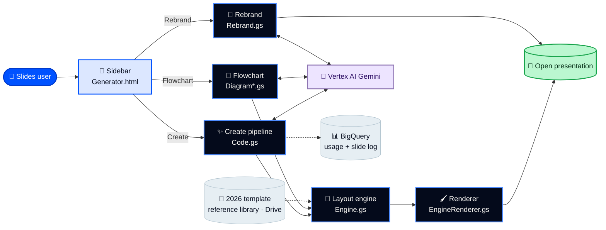
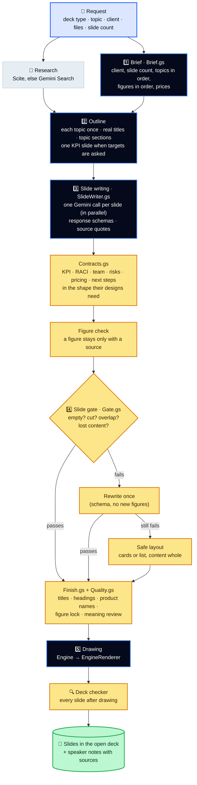
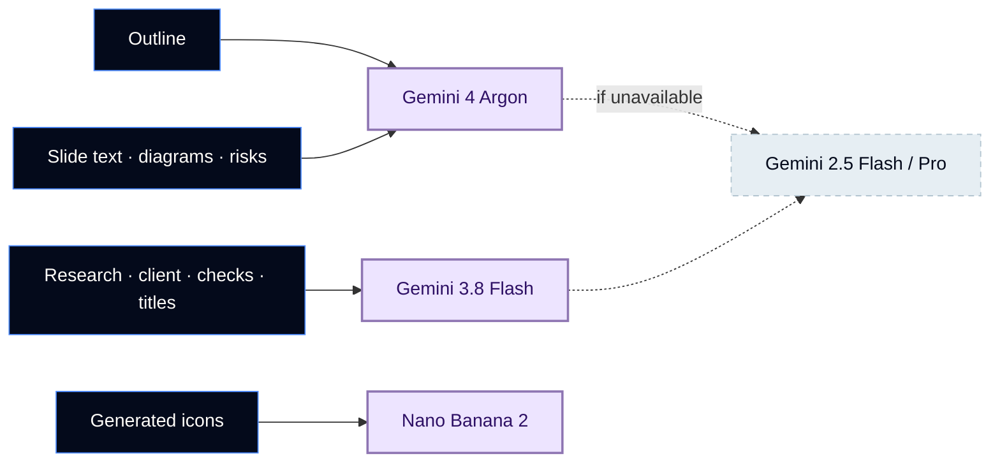
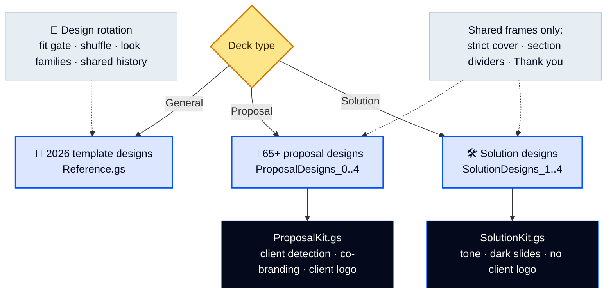
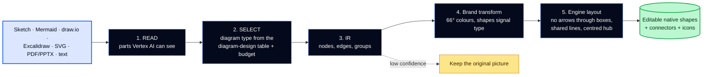
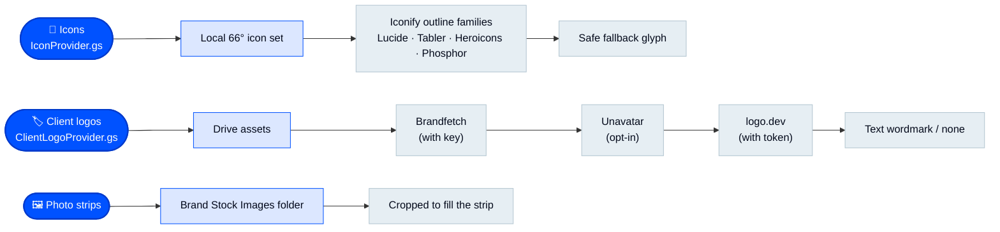
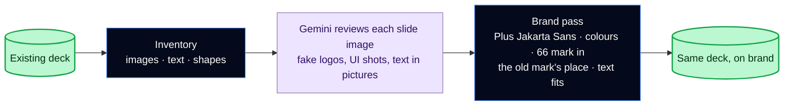
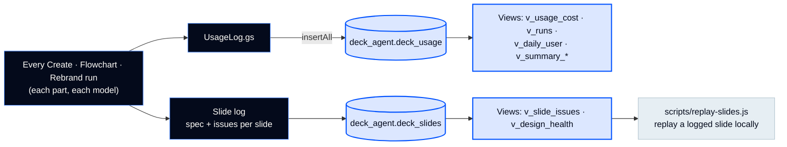
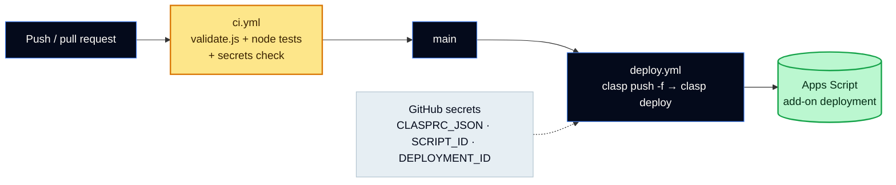

# 🏗️ BrandDeck AI Agent — Architecture

How a prompt becomes on-brand, editable slides inside the presentation that is already open, and how every slide is checked on the way.

**Colour key used in every diagram:** 🟦 people and the sidebar · ⬛ pipeline steps · 🟨 checks and gates · 🟪 Gemini models · 🟩 output · ⬜ Google services and assets

---

## 1. The big picture

**The same-presentation contract:** Create calls `SlidesApp.getActivePresentation()`. A blank deck is reused; a deck with content gets the new slides appended. Rebrand restyles the current deck. Nothing is ever created in a second presentation.

---

## 2. The Create pipeline (V.1_70 – V.1_80)

| Step | Rule that matters most |
|---|---|
| 1. Brief | **The request is the source of truth.** Topics and figures are kept exactly as asked. |
| 2. Outline | Every requested topic gets a slide, once. Phases exactly as listed. |
| 3. Writing | One call per slide; known slide kinds use a response schema so every field is filled. Every statistic carries a 10–20 word `source_quote`. |
| 4. Gate | A failing slide is rewritten once, then drawn with a safe layout. A per-deck budget keeps runs inside Apps Script's time limit. |
| 5. Drawing | Native shapes on a 720×405 canvas scaled to the page; ~3pt rounded boxes; Plus Jakarta Sans. |
| Quality | Figures never change (99.95% stays 99.95%); no absolute promises; product names as their makers write them. **A deck never stops.** |

**Long decks** (up to 200 slides) run in parts of about 4.5 minutes; the sidebar continues automatically and the whole deck appears at once.

---

## 3. Models per job (V.1_56)

Models are set per job in Script properties (`OUTLINE_MODEL`, `CONTENT_MODEL`, `RESEARCH_MODEL`, `IMAGE_MODEL`). The newest models are served on the `global` region. **Test AI models** in the menu checks them. All calls use Vertex AI OAuth.

---

## 4. Deck types and design libraries

---

## 5. Flowchart and diagram intelligence

Rules come from [diagram-design](https://github.com/cathrynlavery/diagram-design) (MIT), vendored in `vendor/diagram-design/` and bundled into `DiagramDesignKit.gs` by `scripts/build-diagram-kit.js`. Its HTML/SVG layer is not used.

---

## 6. Icons, photos and client logos

Icons are chosen by meaning, then recoloured to the brand; SVG is sanitised before insertion. Client logos never replace the 66degrees mark. **A failure never aborts the deck.**

---

## 7. Rebrand

Rebrand keeps the design: grouped shapes are measured on the slide, dark panels keep white text, and text sizes stay uniform per slide.

---

## 8. Usage and slide logs

The log uses the add-on's existing Google Cloud access (no new permission). The user's name and email come from their Google profile. Setup: `setup/usage_bigquery.sql` and `setup/USAGE_SETUP.md`.

---

## 9. Build, test and deploy

Without the deploy secrets, the deploy steps are skipped and nothing fails. `clasp-pull.yml` (manual) pulls the live Apps Script sources for comparison.

---

## 10. Security

- **No keys in code:** Vertex AI uses OAuth; optional keys (Scite, Brandfetch, Unavatar, logo.dev) live in Script properties.
- **Placeholders only:** `.clasp.json` (`REPLACE_WITH_APPS_SCRIPT_ID`), SQL and docs (`your-gcp-project-id`); test people are made up (`@example.com`).
- **Drive:** the add-on uses `DriveApp` only (no runtime Drive API enablement).
- **Uploads and SVG** are sanitised; client domains are validated before any logo lookup.
- **Secrets check** in CI blocks keys, tokens, real project IDs and personal emails.
