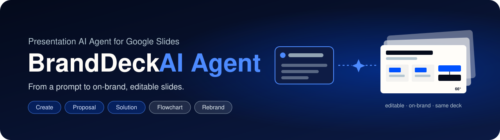
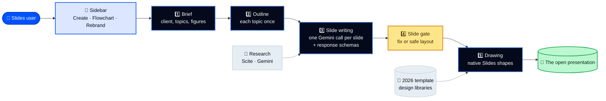

<div align="center">



<br><br>

[](https://github.com/nexoradev-stack/Presentation-AI-Agent/actions/workflows/ci.yml)


[✨ What it does](#-what-it-does) · [🧭 How it works](#-how-it-works) · [🏗️ Architecture](ARCHITECTURE.md) · [🚀 Setup](#-setup) · [📜 Changelog](CHANGELOG.md) · [🙌 Credits](#-credits)

</div>

---

## ✨ What it does

A **Google Slides add-on** that turns a prompt (and optional source files) into **on-brand, editable** 66degrees slides, drawn as native Slides shapes **into the presentation that is already open**.

| | |
|---|---|
| 🧩 **Three modes** | **Create** a deck · turn a sketch or description into an editable **Flowchart** · **Rebrand** an existing deck in place |
| 🗂️ **Three deck types** | **General** · **Proposal** (65+ proposal designs, client cover and logo) · **Solution** (its own design library) |
| 🎯 **The request is the source of truth** | The brief keeps the client, slide count, topics and figures exactly as asked; every requested topic gets a slide |
| 🔢 **Figures you can trust** | A figure stays only if it comes from the request, the files, approved facts or research (with a source quote in the notes). Targets keep their exact value |
| 🧱 **Every slide checked** | Slide shapes, a slide gate before drawing, a deck checker after drawing, and a final quality pass |
| 🎨 **Always on brand** | 2026 template designs, Plus Jakarta Sans, rounded 3pt boxes, brand colours, semantic icons, stock photo strips |
| 📏 **Short or long** | 3 to 200 slides; long decks are built in parts and continue automatically |
| 🔄 **Design rotation** | Decks don't look the same across runs and users |
| 📊 **Usage log** | Every run writes a row per model to BigQuery (who, what, which model, cost view) |
| ✏️ **Fully editable** | Every element is a native Slides shape, picture or text box, not a flat image |

---

## 🧭 How it works



**Models (V.1_56+):** Gemini 4 Argon writes the outline and slides · Gemini 3.8 Flash researches and checks · Nano Banana 2 draws icons · Gemini 2.5 Flash is the fallback. All calls use **Vertex AI OAuth**; there is no API-key path.

Every stage, with a diagram each, is in **[🏗️ ARCHITECTURE.md](ARCHITECTURE.md)**.

---

## 🧩 The three modes

| Mode | What you give it | What you get |
|---|---|---|
| ✨ **Create** | Deck type, topic, optional client name and website (Proposal), links or files as content source, slide count | A complete deck added to the open presentation (blank decks are reused; decks with content get slides appended) |
| 🔀 **Flowchart** | A sketch (PNG/JPG/WebP/GIF), Mermaid, draw.io, Excalidraw, SVG, PDF/PPTX pages, or a plain description | An aligned, editable flowchart slide (plus intro and Thank-you slides), following [diagram-design](https://github.com/cathrynlavery/diagram-design) rules |
| 🎨 **Rebrand** | An existing deck | The same deck restyled to the brand in place: fonts, colours, the 66° mark, text that fits |

> In **Create**, image uploads are **visual references only**: they're never turned into flowchart shapes. Use the **Flowchart** tab for that.

---

## 🗂️ Deck types

| Type | Designs | Special rules |
|---|---|---|
| 📘 **General** | 2026 template library | Agenda sections, section dividers from 18 slides, design rotation |
| 🤝 **Proposal** | 65+ proposal designs (understanding, cards, delivery, proof) | Strict proposal cover with client logo, workstreams, team structure, RACI, risks with mitigations, KPIs, pricing |
| 🛠️ **Solution** | Solution design library (cards, flows, tech, story) | Explains what was built and proves it works; no client logo |

Proposal and Solution decks never borrow each other's designs. Both share only the strict cover, the section dividers and the Thank-you slide.

---

## 🎨 Brand

| Colour | Hex | Used for |
|---|---|---|
| ⬛ Night Blue | `#040A1B` | Dark slides, titles |
| ⬜ 66° White | `#FFFDF9` | Light slides, text on dark |
| 🟦 66° Blue | `#0052FF` | Accent and highlight |
| 🩶 Shark Grey | `#B3C5D0` | Secondary text and lines |

Type is **Plus Jakarta Sans** (with IBM Plex Mono for KPI numbers). Every box has ~3pt rounded corners (`ShapeKit.gs`). Client logos never replace the 66degrees mark.

---

## 📁 Files

| File | Responsibility |
|---|---|
| `Code.gs` | Menu, settings, the Create pipeline, uploads, Gemini/Scite, orchestration |
| `Brief.gs` | Step 1: the brief (client, slide count, topics, figures) and the figure check |
| `SlideWriter.gs` | Step 3: one Gemini call per slide with response schemas and source quotes |
| `Contracts.gs` | Step 3: the shape each slide kind needs (KPI, RACI, team, risks, pricing, next steps) |
| `Gate.gs` | Step 4: the slide gate (rewrite once, then a safe layout) |
| `Finish.gs` | Last text checks: titles, headings, counts, product names, no absolute promises |
| `Quality.gs` | The quality layer: figure lock, per-kind rules, product dictionaries, meaning review |
| `Engine.gs` | Layout engine: every design, type scale, fit measurement (720×405 canvas) |
| `EngineRenderer.gs` | Draws the engine layout into Google Slides safely |
| `Reference.gs` | The 2026 template reference library, design rotation |
| `ProposalKit.gs` · `ProposalDesigns_*.gs` | Proposal Deck kit and designs |
| `SolutionKit.gs` · `SolutionDesigns_*.gs` | Solution Deck kit and designs |
| `Diagram.gs` · `DiagramDesign.gs` · `DiagramDesignKit.gs` | Diagram reading, type selection and editable drawing |
| `IconProvider.gs` | Semantic icons (local 66° set → Iconify → fallback), recoloured to the brand |
| `ClientLogoProvider.gs` | Optional client logos (Brandfetch, Unavatar), always falls back safely |
| `PhotoStrips.gs` · `StockImages.gs` | Photo strips from the brand's stock image folder |
| `Rebrand.gs` | Rebrand mode |
| `Brand.gs` · `ShapeKit.gs` | Brand kit, Gemini client, rounded-box shape kit |
| `UsageLog.gs` · `ModelTest.gs` | BigQuery usage log; model check from the menu |
| `Generator.html` | The sidebar: Create / Flowchart / Rebrand, uploads, progress, Stop |

<details>
<summary><b>📂 Directory structure</b></summary>

```text
Presentation-AI-Agent/
├── .github/workflows/      # ci.yml (tests + secrets check), deploy.yml (clasp), clasp-pull.yml
├── assets/icons/           # 66° icon set (night blue, white, accent blue) + manifest
├── docs/assets/banner.svg
├── scripts/                # validate.js, check-secrets.sh, build-diagram-kit.js, replay-slides.js
├── setup/                  # BigQuery usage log + slide log SQL, USAGE_SETUP.md
├── src/                    # Apps Script sources (.gs, Generator.html, appsscript.json)
├── tests/                  # node:test suites + fixtures from real test decks
├── vendor/diagram-design/  # MIT design reference (not a runtime dependency)
├── .clasp.json             # placeholders: REPLACE_WITH_APPS_SCRIPT_ID
├── ARCHITECTURE.md · CHANGELOG.md · LICENSE
└── README.md
```

</details>

---

## 🚀 Setup

1. **Install and test**
   ```bash
   npm ci
   npm test
   ```
2. **Apps Script project:** enable the **Google Slides API** advanced service. Drive access uses the built-in `DriveApp` only. The manifest requests `presentations`, `drive`, `script.external_request`, `script.container.ui` and `cloud-platform`.
3. **Script properties** (Project Settings). Generation uses **Vertex AI OAuth only** (`ScriptApp.getOAuthToken()`):

   | Property | Required | Notes |
   |---|---|---|
   | `VERTEX_PROJECT_ID` | **Yes** | Your Google Cloud project ID |
   | `VERTEX_LOCATION` | No | `global` for the newest models, or `us-central1` |
   | `OUTLINE_MODEL` · `CONTENT_MODEL` · `RESEARCH_MODEL` · `IMAGE_MODEL` | No | Model per job (defaults in `Code.gs`) |
   | `SCITE_API_KEY` | No | Academic research; Gemini Search is the fallback |
   | `CLIENT_LOGO_LOOKUP` | No | Client logos for Proposal Decks; on unless `false` |
   | `BRANDFETCH_API_KEY` · `UNAVATAR_API_KEY` · `LOGO_DEV_TOKEN` | No | Optional logo providers; skipped without a key |

4. **On the Cloud project:** enable the **Vertex AI API** and give add-on users **Vertex AI User** (`roles/aiplatform.user`).
5. **Usage log (optional):** run `setup/usage_bigquery.sql` and follow `setup/USAGE_SETUP.md`.
6. **First authorisation** runs `ensureInitialSetup_()`, which loads the reference library and brand assets.

The Extensions menu shows: **Open 66° Deck Agent** · **Refresh brand kit** · **Refresh brand assets** · **Test AI models**.

### 🚢 Deploy

Push to `main` (or run `gh workflow run deploy.yml --ref main`). The workflow validates, runs `clasp push -f` and updates the Apps Script deployment. It needs the GitHub secrets `CLASPRC_JSON`, `SCRIPT_ID` and `DEPLOYMENT_ID`. Without them, deploy is skipped and nothing fails.

---

## 🛡️ Renderer safety

- Shape names are normalised (`ROUNDED_RECTANGLE` → `ROUND_RECTANGLE`); unknown names fall back to `RECTANGLE` via `insertShapeSafe_`.
- Every box goes through `safeBox_`: finite width and height above 0.
- Text calls run only on objects with a text frame.
- A slide that fails the gate is drawn with a safe layout that shows all its content. **A deck never stops.**

---

## 🔐 Keys and secrets

- No keys, real project IDs or personal email addresses are stored here. `.clasp.json` and all SQL use placeholders (`REPLACE_WITH_APPS_SCRIPT_ID`, `your-gcp-project-id`); test data uses made-up people (`@example.com`).
- Keys live only in **Script properties** and **GitHub secrets**.
- Every push and pull request runs `bash scripts/check-secrets.sh`.

---

## 🙌 Credits

| Contributor | Role |
|---|---|
| 👤 **[nexoradev-stack](https://github.com/nexoradev-stack)** | Owner, product, design and testing |
| 👤 **[eneelkant](https://github.com/eneelkant)** | Co-builder (original repository: [eneelkant/66-deck-agent](https://github.com/eneelkant/66-deck-agent)) |
| 🤖 **Claude** (Anthropic) | Code, design and docs |
| 🖱️ **Cursor** | AI code editor and agent (co-author on 69 commits) |

Diagram rules: [diagram-design](https://github.com/cathrynlavery/diagram-design) by Cathryn Lavery (MIT), vendored as a design reference.

## 📄 Licence

[MIT](LICENSE).
